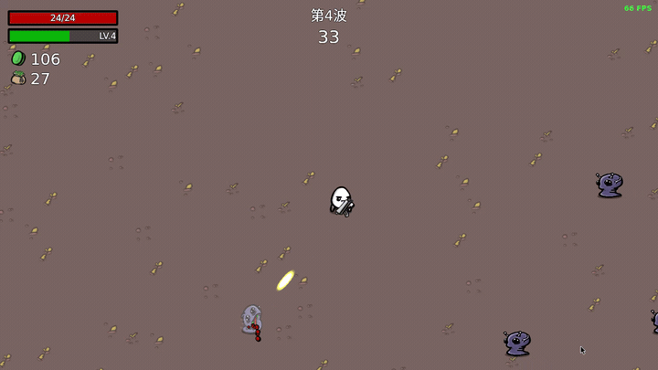
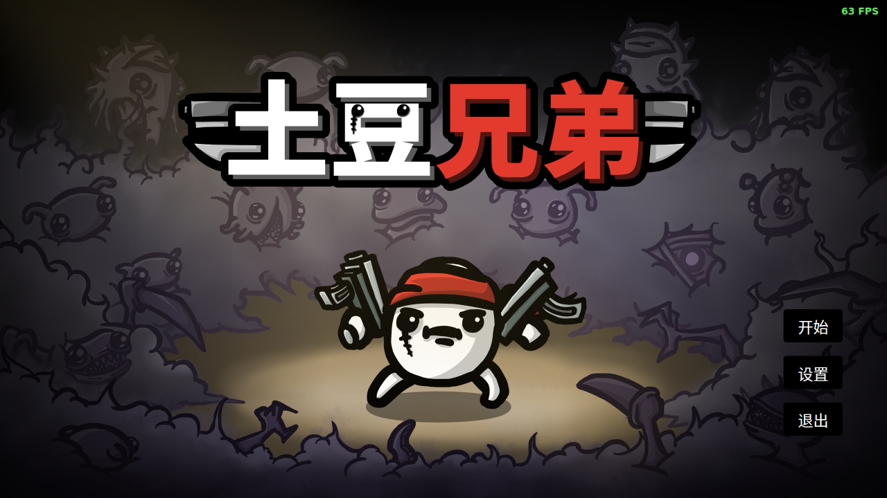
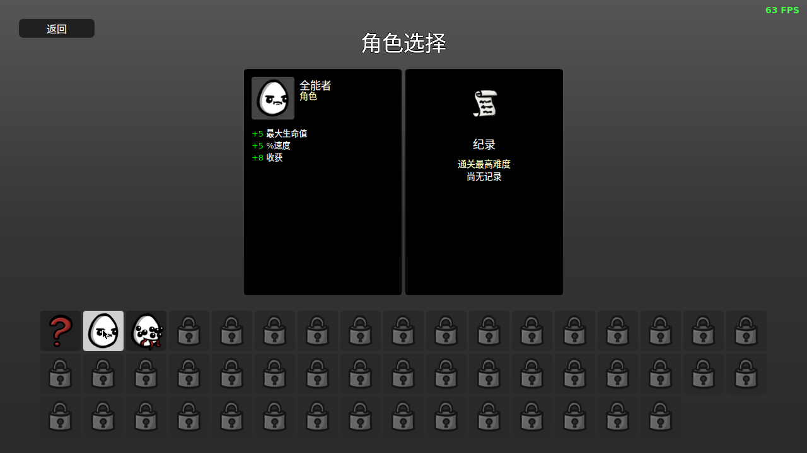
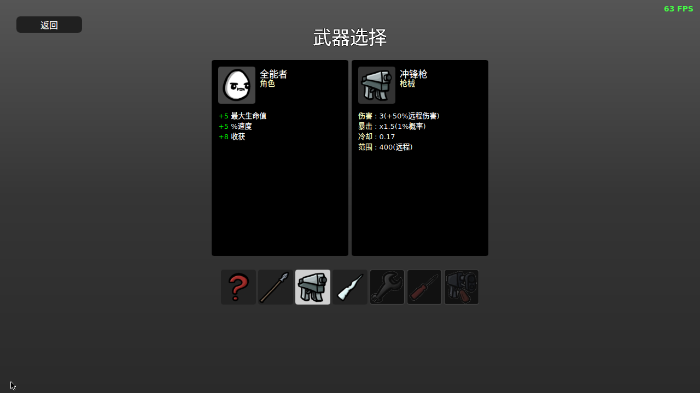
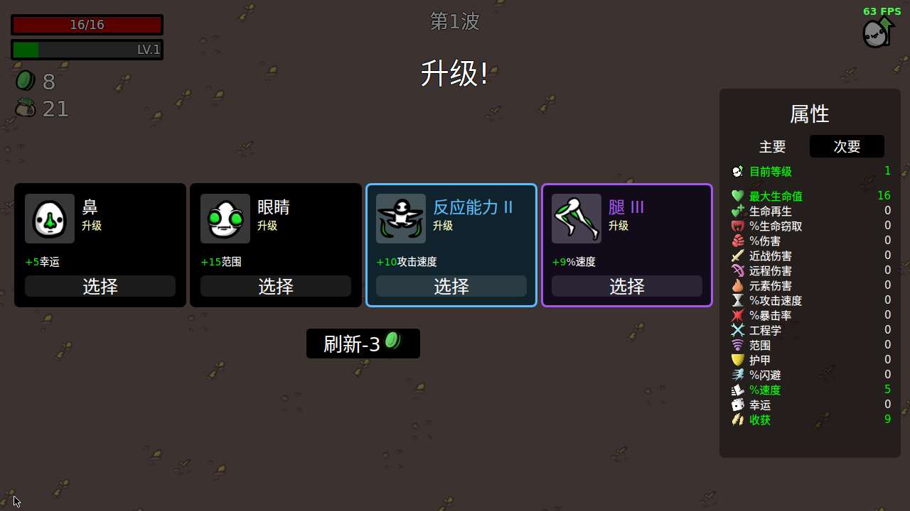
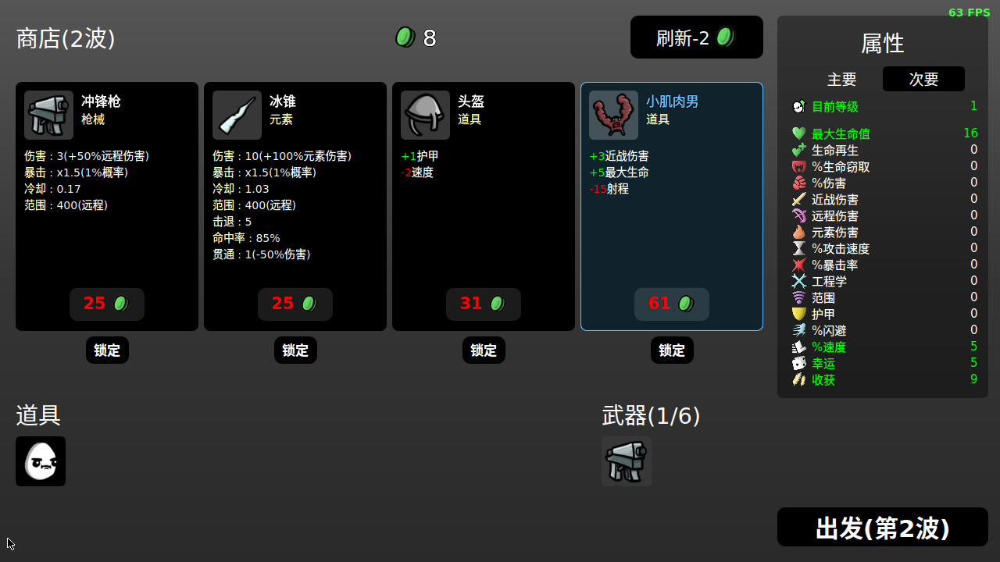
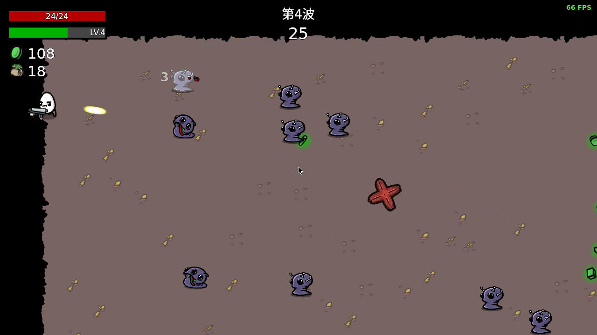

# Brotato — 土豆兄弟玩法复刻（C++23 + Qt 6 QML）

自动射击类幸存者游戏《土豆兄弟》的学习性复刻：**C++23 + Qt 6 QML** 实现，包含自动索敌战斗、升级三选一、波间商店构筑、宝箱结算与完整的局内循环。

<p align="center">
  <a href="https://github.com/Canaohuizhishen/Brotato_Imitation/actions/workflows/build.yml"></a>
</p>

<p align="center">
  
  <br>
  <sub>实战演示：自动索敌射击、走位与掉落吸收</sub>
</p>

<p align="center">
  🎬 <b><a href="docs/media/Brotato_演示_终版_1080p.mp4">完整演示视频</a></b>（2:24 · 1080p60 · 游戏原声 + 解说 + 字幕）
  &nbsp;｜&nbsp;
  <a href="docs/media/Brotato_演示_小版_720p.mp4">720p 轻量版</a>
  &nbsp;｜&nbsp;
  <a href="docs/media/Brotato_演示_字幕.srt">字幕文件（.srt）</a>
</p>

## 特性

- **战斗**：自动索敌 + 武器自动射击；武器定义 6 种（长矛 / 冲锋枪 / 冰锥已实装，扳手 / 螺丝刀 / 火焰喷射器在选择页置灰占位）；12 种出怪类型（冲撞、追猎、吐弹、召唤等行为各异）
- **成长**：击杀掉落经验与材料，升级三选一（16 个升级选项 × 4 等级）；54 件道具（多档稀有度）；角色天赋（全能者 / 异变体）
- **构筑**：波间商店（随机货架、刷新定价、商品锁定）；宝箱「拿取 / 回收」二选一
- **流程**：难度选择 → 20 波敌人（波次配置驱动强度与出怪）；死亡可「重新挑战当前波」（满血重开、收益严格回退）
- **工程**：C++23 / Qt 6.8+（Qt Quick）；GameLoop 分频桶定时器（触发次数与帧率无关）；SpatialGrid 空间网格碰撞筛查；TextPool / ParticlePool 对象池；JSON 数据驱动 + 构建期同步管线（`tools/sync_data.py`）；存档 JSON + `.bak` 自动备份（C++ FileManager ↔ QML 桥）

## 截图

**选择流程**：开始 → 角色 → 武器

| | | |
|---|---|---|
|  |  |  |

**核心循环**：升级三选一 → 商店 → 实战

| | | |
|---|---|---|
|  |  |  |

## 构建与运行

要求：CMake ≥ 3.31、Qt ≥ 6.8（Quick / QuickTest 模块）、支持 C++23 的编译器。

```bash
cmake -B build
cmake --build build
./build/appBrotato
```

> 构建时会自动执行 `tools/sync_data.py`，把 `data/json/` 下的数据表同步生成到 `logic/DataLoader.js`。
> 也可以直接用 Qt Creator 打开 `CMakeLists.txt` 构建运行。

## 测试

```bash
./run_test.sh
```

基于 Qt Quick Test（qmltestrunner）的核心逻辑回归：**166 项用例全绿**，覆盖数据装载（DataLoader）、空间网格（SpatialGrid）、AABB 碰撞与伤害计算、商店定价、升级选项、游戏主循环（GameLoop）、文本 / 粒子池、页面栈（PageManager）、子弹命中回归、死亡重试收益回退等。

CI（`.github/workflows/build.yml`）在 push / PR 时执行 Qt 6.8 单元测试 + Release 构建验证。

## 目录结构

```
Brotato_Imitation/
├── main.cpp / Main.qml / Filemanager.h   # 入口 + C++ 存档桥（.bak 自动备份）
├── page/           # 全屏页面（开始 / 选择流 / 战斗 / 商店 / 升级 / 宝箱 / 结算 …）
├── components/     # 复用组件（HUD / 血条 / 卡片 / 按钮 …）
├── entities/       # 实体（玩家）
├── monsters/       # 怪物（每类独立 QML + 贴图变体）
├── weapons/        # 武器与武器基类（近战 / 远程 / 元素 / 构造）
├── bullets/ drops/ particles/ constructs/   # 子弹 / 掉落 / 粒子 / 构造物
├── logic/          # 纯逻辑 JS（GameLoop / SpatialGrid / 对象池 / 存档 / 商店）
├── data/           # JSON 数据表 + 定制核心（json/ cores/）
├── singleton/      # QML 单例（玩家数据 / 怪物数据）
├── sound/ audio/ images/   # 音效播放与音频 / 贴图资源
├── tests/          # Qt Quick Test 用例
└── tools/          # 数据同步脚本（sync_data.py）
```

## 说明

- 本项目为个人学习作品，**非官方、非商业**；《Brotato》版权归原作者 Blobfish 所有，仅供学习交流，请勿用于任何商业用途。
- 仓库内图片 / 音频等游戏素材版权归原作者所有，如有异议请联系删除。
